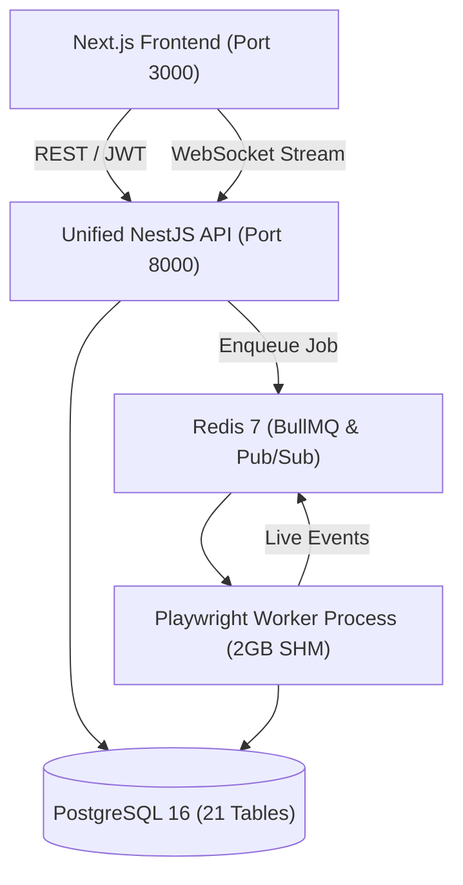

# LowCodeAutomationTestingPlatform
## Unified Enterprise Low-Code Automation & Testing Platform
### Strict Company Data Protection — Zero AI / 100% Deterministic Processing

**LowCodeAutomationTestingPlatform** is a unified, enterprise-grade test automation and visual workflow execution platform. It features visual DAG workflow creation, deterministic browser test automation, live WebSocket execution monitoring, interactive DOM recording, and deterministic self-healing using native **Playwright**.

---

## 🔒 Mandatory Company Data Protection Guarantee

Company data must **NEVER** be shared with AI services. This platform is architected and executed **strictly without AI**:

- ❌ **Zero AI APIs:** No OpenAI, ChatGPT, Claude, Anthropic, Gemini, or external LLM APIs.
- ❌ **Zero Local Inference:** No Ollama, vLLM, HuggingFace, or local model execution.
- ❌ **Zero AI-Generated Locators or Flows:** 100% deterministic algorithms (multi-tier fallback, ARIA semantics, attribute stability, Levenshtein distance).
- ❌ **Zero Outbound Telemetry:** DOM snapshots, screenshots, and logs remain in private storage with automatic secret redaction.
- ✅ **Deterministic Self-Healing:** Rule-based heuristics with multi-factor scoring and human approval gates.

---

## 🛠 Technology Stack

- **Frontend:** Next.js 16 (App Router), React 19, TypeScript, Tailwind CSS, `@xyflow/react` (React Flow), Recharts, Lucide Icons.
- **Backend:** Node.js 20 LTS, NestJS 10, TypeScript, TypeORM (PostgreSQL only, `synchronize: false`).
- **Browser Automation:** Playwright (Chromium isolated contexts).
- **Execution & Queue:** Redis 7, BullMQ, WebSocket Gateway (Live streaming & Redis Pub/Sub).
- **Database:** PostgreSQL 16 (21 enterprise tables with UUID keys, foreign key cascades, and JSONB definitions).
- **Security:** AES-256-GCM Credential Vault, JWT RBAC, Immutable Audit Logging.
- **Deployment:** Docker & Docker Compose 5-service orchestration with automated healthchecks.

---

## 🏛 Unified Architecture Overview

There is only **ONE unified backend codebase** (`backend/`):
- **API Server (`main.ts`)**: Serves HTTP REST on port 8000, Swagger at `/api/docs`, and WebSocket at `/ws/executions/:id`.
- **Worker Process (`worker.ts`)**: Standalone background BullMQ consumer with `shm_size: 2gb` running isolated Playwright browser executions. Never runs browser jobs inside the API process.



---

## 📁 Repository Structure

```text
AutomationTestingWithAgentBrowser/
├── .devcontainer/         # Pre-configured container environment, Docker Compose & build scripts
├── backend/               # Unified NestJS API & standalone Playwright BullMQ Worker
│   ├── .env.example       # Backend environment configuration template
│   ├── src/               # Application modules, entities, worker, and services
│   └── test/              # Unit, integration, and E2E test suites
├── frontend/              # Next.js 16 Web Dashboard & Visual Automation Flow Builder
│   ├── .env.example       # Frontend environment configuration template
│   └── src/               # App Router pages, components, and context providers
├── .gitignore             # Comprehensive Git exclusion rules
├── LICENSE                # MIT License
└── README.md              # Project documentation and quick start guide
```

---

## 🐳 Quick Start with Dev Container (VS Code / Codespaces)

A complete, pre-configured development environment is included in [`.devcontainer/`](.devcontainer/):

- **One-Click Startup:** In VS Code, click **"Reopen in Container"** (or open in **GitHub Codespaces**).
- **Pre-installed Stack:** Node.js 20, native Playwright browsers (Chromium, Firefox, WebKit), PostgreSQL 16 (`5432`), Redis 7 (`6379`), Jest runner, and database tools.
- **Auto-install:** Dependencies for both backend and frontend are installed automatically on container creation.

```bash
# Launch PostgreSQL and Redis via Dev Container Compose (if running locally outside VS Code):
docker compose -f .devcontainer/docker-compose.yml up -d postgres redis
```

---

## 🚀 Local Development Setup

### 1. Launch PostgreSQL and Redis
```bash
docker compose -f .devcontainer/docker-compose.yml up -d postgres redis
```

### 2. Configure Environment Variables
```bash
# Backend configuration
cp backend/.env.example backend/.env

# Frontend configuration
cp frontend/.env.example frontend/.env.local
```

### 3. All-In-One Single Start Commands (HMR Included)

Start the entire platform (NestJS API, Playwright BullMQ Worker, Next.js Web Dashboard) with Hot Module Replacement built in:

```bash
# Start all 3 services concurrently with HMR (API on :8000, Worker, Frontend on :3000):
make dev
# Or using npm:
npm run dev

# Start web stack only with HMR (API + Frontend without worker):
make dev-web
# Or using npm:
npm run dev-web
```

### 4. Individual Service Commands (HMR Included)

If you prefer running services in separate terminal tabs (Hot Module Replacement is active by default):

```bash
# 4a. Install Dependencies
make install-backend
make install-frontend
# Or both:
make install

# 4b. Run Backend API Server (Port 8000 with Webpack HMR)
make backend

# 4c. Run Standalone Playwright Worker Process
make worker            # or: make backend-worker

# 4d. Run Frontend Web Dashboard (Port 3000 with Fast Refresh & HMR polling)
make frontend
```

---

## 🧪 Testing

```bash
# Run backend test suites
cd backend
npm test

# Typecheck frontend
cd frontend
npx tsc --noEmit
```

---

## 📄 License

This project is licensed under the MIT License — see the [LICENSE](LICENSE) file for details.
