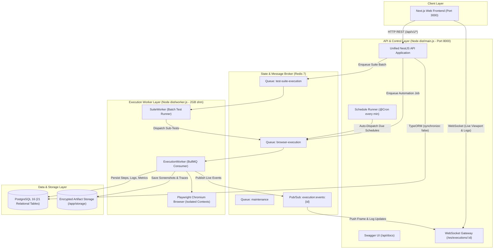

# Enterprise System Architecture

## 1. High-Level Architecture Overview

The **LowCodeAutomationTestingPlatform** has been unified into a single enterprise-grade Node.js / TypeScript codebase powered by **NestJS**, **Playwright**, **PostgreSQL 16**, **Redis 7**, **BullMQ**, and **Next.js**.

All runtime dependencies on Python, FastAPI, and Celery have been eliminated from the production path.

---

## 2. Key Architectural Guarantees

### A. Separation of API and Worker Processes
- **API Process (`main.ts`)**: Boots HTTP REST controllers, Swagger documentation, WebSocket gateway, and cron evaluator. Never registers BullMQ consumers or launches browser automation.
- **Worker Process (`worker.ts`)**: Boots BullMQ consumers with `shm_size: 2gb` and isolated Playwright browser contexts. Never binds an HTTP listener.

### B. Single Browser Engine: Playwright
- Playwright is the sole browser automation engine.
- Supports deterministic actions (`click`, `fill`, `type`, `selectOption`, `check`, `uncheck`, `scroll`).
- Supports 13 deterministic assertion types (`element_visible`, `text_equals`, `value_equals`, `title_equals`, etc.).
- Eliminates brittle subprocess wrappers and external CLI dependencies.

### C. Strict Zero-AI Policy Enforced
- 100% deterministic selector resolution with multi-tier fallback (Exact CSS/XPath -> Stable Data Attributes -> ID/Name).
- Self-healing element recognition uses structural DOM fingerprints and attribute scoring algorithms; zero external AI calls or LLMs.

### D. PostgreSQL Schema Ownership
- 21 mapped TypeORM entities in `src/database/entities/`.
- Strict `synchronize: false` in production and test environments.
- Alembic migration history preserved intact in `alembic/`.

### E. Cryptographic Credential Vault
- AES-256-GCM encryption with 12-byte IV and 16-byte authentication tag.
- Output encoded as URL-safe base64, guaranteeing 100% byte-level interoperability with records previously encrypted by Python cryptography.
